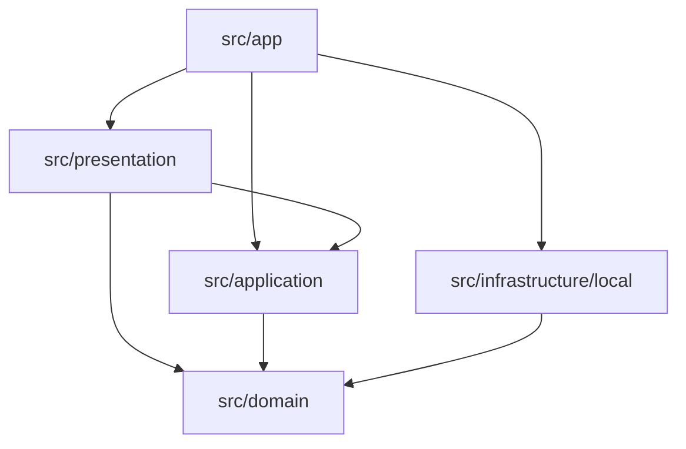
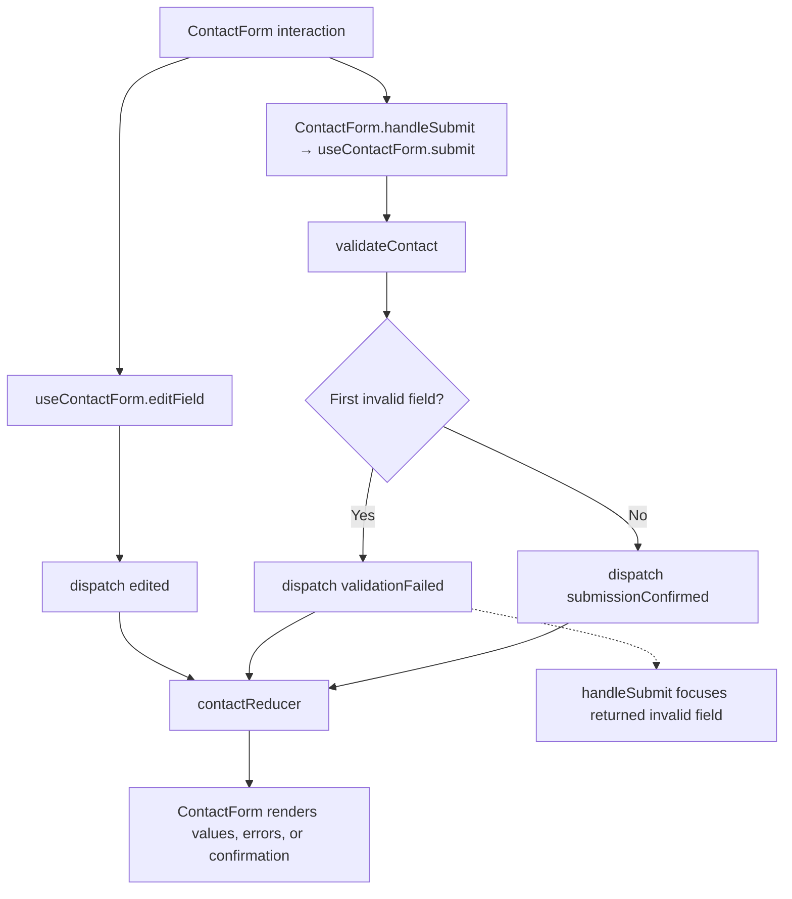

<h1 style="font-family: 'Plus Jakarta Sans', sans-serif; font-size: 25px; font-weight: 800; letter-spacing: -0.09em; color: #171B2C;">luma.</h1>

### Build skills that move you forward

I built Luma test code as a responsive learning environment: a focused introduction to practical learning, a local course preview, a community presentation, and a contact experience. My implementation brings those sections together with typed content, explicit state transitions, and a layered structure that makes each responsibility easy to locate.

**Next.js App Router · React · TypeScript · Tailwind CSS**  
**Author: Leonardo Sousa**

[Project scope](#project-scope) · [Architecture](#my-layered-architecture) · [State flow](#my-flux-inspired-state-flow) · [Source reference](#source-reference) · [Run locally](#run-locally)

---

## Project scope

I implemented a single page with a header, hero, four course categories, one featured course, three learning steps, a testimonial and metrics, a community collage, a contact form, a final call to action, and footer navigation.

Content comes from TypeScript modules in `src/infrastructure/local`. Category cards are derived from those modules before they reach the presentation layer. The displayed counts, ratings, testimonial, and course information are local demonstration content; they are not live analytics or a fetched catalog.

### Current interactions

| Control or feature | Implemented behavior |
| --- | --- |
| Header navigation | Courses → `#courses`; For Teams and Community → `#community`; About → `#how-it-works`. |
| Start learning | Moves to `#courses`, including from the mobile menu. |
| Luma wordmarks | Use `href="#"` to return to the top of the page. |
| Skip to content | Moves to `#main`. |
| Hero actions | Explore courses → `#courses`; See how it works → `#how-it-works`. |
| Category Explore buttons | Open local dialogs with a category description. The category matching the featured course also displays its title. |
| View course | Opens a local dialog containing the featured course description, instructor, and lesson metadata. |
| Browse all courses | Moves to `#courses`, the category section. |
| Community action | Opens a local informational dialog about the displayed community. |
| Log in | Opens an informational dialog explaining that sign-in is unavailable. This action is in the desktop header; the mobile menu contains navigation links and Start learning. |
| Contact email | Uses `mailto:contact@luma.com`, delegating to the visitor's email application. |
| Final actions | Explore all courses → `#courses`; Join Luma → `#contact`. |
| Footer Explore group | Courses → `#featured`; Categories → `#courses`; Instructors and For Teams → `#community`. |
| Footer Company group | About → `#how-it-works`; Careers opens an availability dialog; Journal is unavailable and does not open a dialog. |
| Footer Support group | Help Center and Contact → `#contact`; Terms and Privacy open informational dialogs. |

I kept these destinations within the implemented page. Course playback, enrollment, account authentication, journal pages, career listings, and full legal documents are outside the current implementation.

### Contact behavior

I implemented controlled fields for `name`, `email`, and `message`. Submission checks trimmed values for required fields and uses a basic email format expression. Errors are returned as structured codes and rendered using the selected copy. Editing a field clears its own error and dismisses any previous confirmation.

An invalid submission keeps the values, displays errors, and focuses the first invalid control in the order `name`, `email`, `message`. A valid submission immediately dispatches `submissionConfirmed`, resets the fields, clears the errors, and displays a **simulated confirmation**. No request is sent, and submissions are not persisted. State belongs to the mounted form instance.

The form body selects Portuguese copy at widths up to **767px**, and English copy above that breakpoint. This selection follows the viewport, not a language preference. Its `lang` attribute follows the chosen copy; the surrounding page remains English. On the server, the viewport snapshot is `false`, so the initial form copy is English before the client viewport snapshot is applied.

## My layered architecture

I chose a layered architecture to establish a clear separation of responsibilities. I organized composition, contracts, rules, local data, and presentation into modules with explicit boundaries. This organization lets me locate changes and understand their dependencies more easily.

| Layer | Directory | Responsibility in Luma |
| --- | --- | --- |
| Composition | [`src/app`](src/app) | Connect the page sections, concrete content, application transformation, metadata, fonts, and styles. |
| Domain | [`src/domain`](src/domain) | Define feature-specific content and value contracts without React or browser dependencies. |
| Application | [`src/application`](src/application) | Derive category cards, validate contact values, and calculate form and menu transitions. |
| Local infrastructure | [`src/infrastructure/local`](src/infrastructure/local) | Supply typed content fixtures and local image paths. |
| Presentation | [`src/presentation`](src/presentation) | Render sections, handle DOM interaction, coordinate local state through hooks, and apply Tailwind utility classes and shared global styles. |

### Home as the composition point

I separated concrete content selection from section rendering in `Home`, exported from `src/app/page.tsx`. The page imports the local modules and section components. At module scope, `buildCategoryCards(categories, course)` derives the cards. `Home` then supplies the resulting cards and local content through the components' typed props.

For example, `Hero` receives `content: HeroContent`; `Featured` receives `course: Course`; `Categories` receives `cards: readonly CategoryCard[]` and `content: CategoriesContent`. These presentation modules do not import their concrete fixtures. `ContactForm` and its hook consume application operations, while domain types describe their values and content.

`RootLayout` supplies the document shell and imports the fonts and `globals.css`. I kept those document concerns separate from the page's section composition.

The arrows below mean **source import dependencies**, from the importing layer to the imported layer. Some are type-only imports; this is not a runtime request or event sequence.



These boundaries are visible in the imports. I have not added an automated architecture enforcement rule, a repository interface, or a dependency injection container.

## My Flux-inspired state flow

I chose a unidirectional flow inspired by Flux to organize interactions, typed actions, and state updates. I combined this flow with the layered architecture to keep data and rules organized and allow the interface to reflect the current state.

| Mechanism | Role |
| --- | --- |
| Layers | Organize responsibilities and import dependencies. |
| Reducers | Calculate transitions of local interaction state. |
| Props | Supply content and derived data to components. |
| React rendering | Reflect the current state in values, errors, confirmation, and navigation visibility. |

I implemented this with React's `useReducer`, rather than a separate Flux dispatcher or global store. The form and menu each own their state. Discriminated action unions make their permitted actions explicit: `ContactAction` uses `edited`, `validationFailed`, and `submissionConfirmed`; `MenuAction` uses `toggled` and `closed`.


### Form flow



`editField` dispatches an edit without running a complete validation pass. `submit` calls `validateContact`, finds the first error using `contactFields`, and either returns that field after dispatching failure or dispatches confirmation. The reducer calculates the corresponding state; React renders it.

I kept focus handling in the UI: `handleSubmit` prevents native submission, calls `submit`, looks up the returned control through `event.currentTarget.elements.namedItem`, and focuses it when it is an `HTMLElement`. Neither validation nor the reducer reaches into the DOM.

This separation makes a transition readable as a specific input and result. I can inspect required-field validation independently from focus behavior, and inspect the confirmation reset independently from the copy rendered by the component. Those are benefits for understanding, verification, and maintenance; they do not establish a runtime speed improvement.

### Mobile menu flow

`MobileMenu` initializes `useReducer(menuReducer, false)`. The toggle button dispatches `toggled`; selecting a navigation link calls `closeMenu`, which dispatches `closed`. `handleKeyDown` also closes an open menu on Escape and returns focus to the toggle button.

`menuReducer` returns the inverted boolean for `toggled` and `false` for `closed`. React then updates the navigation's `hidden` attribute, the button label, its symbol, and `aria-expanded`. The button also connects to the navigation through `aria-controls="mobile-navigation"`.

## My application of SOLID

I applied these principles where the functions and component boundaries support them. I do not treat the presence of TypeScript types or React components alone as proof of every SOLID principle.

### Single responsibility

| Unit | Responsibility I separated |
| --- | --- |
| `validateContact` | Check values and return structured errors. |
| `contactReducer` | Calculate form state transitions. |
| `useContactForm` | Coordinate edits, validation, and simulated confirmation. |
| `ContactForm` | Render controls and feedback; handle DOM events and invalid-field focus. |
| `useMobileViewport` | Encapsulate the viewport subscription and snapshots. |
| `menuReducer` | Calculate menu state transitions. |
| Section components | Render the content and local controls belonging to their section. |

With these boundaries, changing an error message belongs to the local copy, changing a validation condition belongs to the validator, and changing focus behavior belongs to the form component.

### Open/closed

I chose composition in `DetailsDialog` so different callers can supply `children`, `id`, `label`, `title`, and an optional `className` while sharing the existing modal behavior. Categories, the featured course, the community, the header, and the footer compose different dialog contents without duplicating `showModal()` and close-form handling.

This is a concrete extension point for content and styling. A new interaction requirement could still require changes to the dialog implementation.

### Interface segregation

I organized contracts by feature rather than introducing a page-wide object that every component must accept. `Hero` receives `HeroContent`; `Community` receives `CommunityContent`; `HowItWorks` receives `readonly Step[]` and `LearningContent`; `Testimonial` receives `TestimonialContent` and `readonly Metric[]`.

The narrower form boundary is also explicit: `ContactForm` receives `title: string` and `copy: ContactContent['form']`, rather than the complete contact section content. `MobileMenuProps` contains navigation links and `startLearning`; it does not include the header's login dialog data.

### Dependency inversion

I separated presentation from concrete local fixtures through typed props. `Home` gathers those concrete modules and supplies objects matching the feature contracts. A section can therefore render another compatible content object without importing or changing its fixture module.

The application modules also depend on domain value contracts. This demonstrates dependency direction through contracts and manual composition. It does not constitute an interchangeable persistence adapter or service abstraction: no such adapter contract is implemented, and presentation still imports the concrete application functions it uses.

### Liskov substitution

I do not claim a concrete Liskov substitution example in this code. There is no implemented base/subtype behavior or pair of interchangeable implementations whose behavioral substitution can be verified. Compatible prop shapes establish structural typing; that alone does not prove behavioral substitutability.


## Clean Code and readability

| Practice I applied | Concrete example | Benefit |
| --- | --- | --- |
| Responsibility-based names | `buildCategoryCards`, `validateContact`, `closeMenu`, `subscribeToViewport` | Make the purpose of an operation visible at its call site. |
| Typed contracts and props | Domain content types, `ContactField`, `ContactErrors`, `HeaderProps`, and `MobileMenuProps` | Describe required data and restrict invalid field/action combinations during type checking. |
| Validation outside rendering | `validateContact` returns error codes; `ContactForm` selects their text. | Keep rules readable without JSX or copy concerns. |
| Explicit state actions | `edited`, `validationFailed`, `submissionConfirmed`, `toggled`, `closed` | Make the reason for each transition traceable. |
| Content grouped by feature | Local catalog, contact, navigation, and other content modules | Locate copy and fixture changes without searching through section markup. |
| Shared data and behavior | `learnerAvatars` and `DetailsDialog` | Reduce duplicated paths and modal handling. |
| Tailwind and shared global styles | Tailwind utility classes in components and `src/app/globals.css` | Keep component styling near its markup while centralizing theme tokens and shared base rules. |
| State near its consumer | Form state in `useContactForm`; menu state in `MobileMenu` | Avoid introducing a global store for interactions used by one feature. |

I use these choices to improve reading, maintenance, and the ability to verify behavior. I have not measured a runtime performance gain from file organization, SOLID, or reducers.

### Accessibility and loading mechanisms present in the code

I implemented a skip link, semantic landmarks, labeled section headings, associated form labels, error descriptions with `aria-describedby`, `aria-invalid`, and a confirmation region with `role="status"`. The menu exposes its expanded state and handles Escape. `DetailsDialog` uses the native `<dialog>` element with `showModal()`, an accessible title relationship, and a close button inside `form method="dialog"`.

Meaningful hero and course images receive descriptive alternative text. Decorative avatar groups and the collage are hidden from assistive technology; their images use empty alternative text. Global CSS defines a visible keyboard focus outline. These are implementation observations, not a certification of accessibility compliance or a screen-reader audit.

I used `next/image`, explicit dimensions or `fill` with `sizes`, a preloaded hero image, and locally imported variable font packages. The build prerenders `/` as static content. These mechanisms are present in the implementation; I do not attach unmeasured loading-time or Lighthouse claims to them.

## Source reference

I grouped every file under `src` below by its actual responsibility. Paths are relative to the project root. The tables distinguish executable functions from contracts, content, and global styles.

<details>
<summary><strong>Composition and global styles — 3 files</strong></summary>

| File | Exports or relevant functions | Responsibility | Consumer | Applicable choice |
| --- | --- | --- | --- | --- |
| [`src/app/page.tsx`](src/app/page.tsx) | Default `Home`; module-level `categoryCards` | Build category cards once at module evaluation, compose the header, main sections, footer, and skip link, and pass typed content into sections. | Next.js App Router | Composition point; layered architecture; concrete dependency assembly. |
| [`src/app/layout.tsx`](src/app/layout.tsx) | `metadata`; default `RootLayout` | Define the page title/description, import both variable fonts and `globals.css`, and render `html lang="en"`, `body`, and `children: ReactNode`. | Next.js App Router | Document composition; separation from page content. |
| [`src/app/globals.css`](src/app/globals.css) | No functions or TypeScript exports | Import Tailwind; define theme tokens, color variables, base typography, and global focus rules. | `RootLayout`; Tailwind utilities used in presentation components | Shared styling organization. |

</details>

<details>
<summary><strong>Application — 4 files</strong></summary>

| File | Exports or relevant functions | Responsibility | Consumer | Applicable choice |
| --- | --- | --- | --- | --- |
| [`src/application/catalog/category-cards.ts`](src/application/catalog/category-cards.ts) | `CategoryCard`; `buildCategoryCards` | Map `readonly Category[]` into new objects, adding `featuredCourseTitle` when a category ID matches `course.categoryId`; use `undefined` otherwise. `CategoryCard` extends the category shape with this derived field. | `Home` calls the function; `Categories` consumes the type. | Pure transformation; separation of derivation from JSX. |
| [`src/application/contact/validate-contact.ts`](src/application/contact/validate-contact.ts) | `contactFields`; `ContactErrors`; `validateContact` | Declare ordered field names; represent optional field errors as `Partial<Record<ContactField, ContactError>>`; check trimmed required values and a basic email format without mutating the supplied values. | `useContactForm`, `ContactForm`; error type used by `contactReducer`. | Single responsibility; structured validation. |
| [`src/application/contact/contact-reducer.ts`](src/application/contact/contact-reducer.ts) | `initialContactState`; `contactReducer`; internal `ContactState` and `ContactAction` | Define empty values, no errors, and `submitted: false`; calculate the `edited`, `validationFailed`, and `submissionConfirmed` transitions. | `useContactForm` | Reducer pattern; discriminated actions; immutable updates. |
| [`src/application/navigation/menu-reducer.ts`](src/application/navigation/menu-reducer.ts) | `MenuAction`; `menuReducer` | Accept `toggled` or `closed`; calculate the next open/closed boolean. | `MobileMenu` | Reducer pattern; explicit local transitions. |

**`initialContactState`.** I use empty strings for all three fields, an empty error object, and a false confirmation flag. It is the initial reducer value and the basis for a successful reset.

**`contactReducer`.** For `edited`, I copy the current errors, delete the edited field's error, copy values with the new field value, and clear confirmation. `validationFailed` preserves values and replaces errors while clearing confirmation. `submissionConfirmed` returns the initial values/errors with `submitted: true`.

**`validateContact`.** I iterate over `contactFields`, mark whitespace-only values as `required`, and apply the email expression only when email has not already failed the required check. The result contains codes rather than translated messages. This validates the demonstration form's basic rules; it does not verify whether an address can receive mail.

</details>

<details>
<summary><strong>Domain contracts — 9 files</strong></summary>

| File | Exports | Responsibility | Consumer | Applicable choice |
| --- | --- | --- | --- | --- |
| [`src/domain/catalog.ts`](src/domain/catalog.ts) | `Category`, `Course`, `CategoriesContent` | Describe category identity/copy, the featured course with image/navigation/metadata, and category section copy. `Course.categoryId` uses `Category['id']`; the navigation shape comes from `NavigationLink`. | Catalog fixtures, category-card transformation, `Categories`, `Featured`. | Feature contracts; interface segregation. |
| [`src/domain/community.ts`](src/domain/community.ts) | `CommunityContent` | Describe headings, copy, dialog text, and readonly columns of collage image descriptors. | Community fixture and `Community`. | Feature contract. |
| [`src/domain/contact.ts`](src/domain/contact.ts) | `ContactField`, `ContactValues`, `ContactError`, `ContactFormCopy`, `ContactContent` | Define the field union, string value record, error-code union, localized labels/messages, and section content including `form.en` and `form.pt`. | Contact fixture, validator, reducer, form hook, `ContactForm`, `Contact`. | Typed values; separation of codes and copy; feature contracts. |
| [`src/domain/final-cta.ts`](src/domain/final-cta.ts) | `FinalCtaContent` | Describe title, subtitle, readonly avatars, and two `NavigationLink` actions. | Final CTA fixture and `FinalCta`. | Feature contract; reused navigation shape. |
| [`src/domain/footer.ts`](src/domain/footer.ts) | `FooterItem`, `FooterContent` | Represent each item as either `{ label, href }` or `{ label, detail }`; describe grouped navigation, tagline, and copyright. | Footer fixture and `Footer`. | Specific union contract; branch narrowing through `'href' in link`. |
| [`src/domain/hero.ts`](src/domain/hero.ts) | `HeroContent` | Describe hero actions, headings, trust content, avatars, image, course count, stars, and viewport-specific rating strings. | Hero fixture and `Hero`. | Feature contract. |
| [`src/domain/learning.ts`](src/domain/learning.ts) | `Step`, `LearningContent` | Describe learning steps with mobile/desktop numbering and the constrained `blue`, `orange`, or `yellow` color values; define section headings. | Learning fixtures and `HowItWorks`. | Feature contract; constrained visual variants. |
| [`src/domain/navigation.ts`](src/domain/navigation.ts) | `NavigationLink` | Define the shared `{ label: string; href: string }` link shape. | Navigation fixtures, catalog/hero/final CTA contracts, `Header`, `MobileMenu`. | Small shared contract. |
| [`src/domain/testimonial.ts`](src/domain/testimonial.ts) | `Metric`, `TestimonialContent` | Describe metric values/labels and quote, identity, portrait, and mobile/desktop role text. | Testimonial fixtures and `Testimonial`. | Feature contracts. |

I kept these modules as types. They do not fetch content, maintain React state, or perform runtime validation. Their readonly array declarations constrain TypeScript usage; they do not freeze objects at runtime.

</details>

<details>
<summary><strong>Local infrastructure — 10 files</strong></summary>

| File | Exports or relevant operations | Responsibility | Consumer | Applicable choice |
| --- | --- | --- | --- | --- |
| [`src/infrastructure/local/catalog.ts`](src/infrastructure/local/catalog.ts) | `categories`, `categoriesContent`, `course` | Supply four categories, category section copy, and one featured course, including the matching `categoryId`, local photo, metadata, and local browse destination. | `Home`; category-card transformation through arguments. | Centralized feature fixtures. |
| [`src/infrastructure/local/community.ts`](src/infrastructure/local/community.ts) | `community`; nested `map` expressions | Supply community copy and dialog text; transform image IDs into readonly-compatible collage columns with `/images/${id}.jpg` paths. | `Home` → `Community`. | Feature fixture organization; data shaping. |
| [`src/infrastructure/local/contact.ts`](src/infrastructure/local/contact.ts) | `contact` | Supply section copy, email link, response-time text, form heading, English/Portuguese fields, error text, and simulated success messages. | `Home` → `Contact` → `ContactForm`. | Centralized feature and localized copy. |
| [`src/infrastructure/local/final-cta.ts`](src/infrastructure/local/final-cta.ts) | `finalCta` | Supply final title/subtitle, complete shared avatar list, and course/contact anchors. | `Home` → `FinalCta`. | Typed fixture; shared data reuse. |
| [`src/infrastructure/local/footer.ts`](src/infrastructure/local/footer.ts) | `footer` | Supply tagline, copyright, grouped section links, and details for availability/privacy dialogs. | `Home` → `Footer`. | Typed fixture; union-shaped link content. |
| [`src/infrastructure/local/hero.ts`](src/infrastructure/local/hero.ts) | `hero`; `learnerAvatars.slice(0, 3)` | Supply hero copy, anchors, image, local counts/ratings, and the first three avatars in the shared order. | `Home` → `Hero`. | Typed fixture; shared data selection. |
| [`src/infrastructure/local/learner-avatars.ts`](src/infrastructure/local/learner-avatars.ts) | `learnerAvatars` | Declare the ordered readonly list of four local avatar paths. | Local hero and final CTA modules. | Single source of data. |
| [`src/infrastructure/local/learning.ts`](src/infrastructure/local/learning.ts) | `steps`, `learning` | Supply three learning steps, decorative colors, viewport-specific numbering, and section headings. | `Home` → `HowItWorks`. | Centralized feature fixtures. |
| [`src/infrastructure/local/navigation.ts`](src/infrastructure/local/navigation.ts) | `navigation`, `startLearning`, `login` | Supply the header/menu links, course CTA, and unavailable-sign-in dialog title/message. | `Home` → `Header`; relevant links forwarded to `MobileMenu`. | Centralized navigation content. |
| [`src/infrastructure/local/testimonial.ts`](src/infrastructure/local/testimonial.ts) | `testimonial`, `metrics` | Supply the local quote/portrait/role variants and three demonstration metrics. | `Home` → `Testimonial`. | Centralized feature fixtures. |

These are synchronous local modules. I did not implement a CMS connection, database, remote catalog request, or durable browser storage.

</details>

<details>
<summary><strong>Presentation: hooks, interactions, and shared behavior — 5 files</strong></summary>

| File | Exports or relevant functions | Responsibility | Consumer | Applicable choice |
| --- | --- | --- | --- | --- |
| [`src/presentation/contact/use-contact-form.ts`](src/presentation/contact/use-contact-form.ts) | `useContactForm`; nested `editField`, `submit` | Own reducer state and expose values, errors, confirmation, and coordination operations. | `ContactForm` | Custom Hook; Flux-inspired local coordination. |
| [`src/presentation/contact/ContactForm.tsx`](src/presentation/contact/ContactForm.tsx) | `ContactForm`; nested `handleSubmit`; field mapping and `onChange` handler | Select viewport copy, render controlled inputs/textarea, label/error/status relationships, prevent native submission, and focus an invalid field. | `Contact` | UI responsibility; typed props; accessible feedback mechanisms. |
| [`src/presentation/navigation/MobileMenu.tsx`](src/presentation/navigation/MobileMenu.tsx) | `MobileMenu`; internal `MobileMenuProps`; nested `closeMenu`, `handleKeyDown` | Render mobile navigation, maintain local open state, dispatch menu actions, and handle Escape/focus restoration. | `Header` | Reducer pattern; local state; DOM behavior in presentation. |
| [`src/presentation/shared/DetailsDialog.tsx`](src/presentation/shared/DetailsDialog.tsx) | `DetailsDialog`; inline opening callback | Render a trigger and labeled native modal; share opening and close-form behavior while accepting content and styling props. | `Header`, `Categories`, `Featured`, `Community`, `Footer`. | Composition through `children`; content extension point. |
| [`src/presentation/shared/use-mobile-viewport.ts`](src/presentation/shared/use-mobile-viewport.ts) | `useMobileViewport`; internal `mobileQuery`, `subscribeToViewport`, `isMobileViewport`, `getServerSnapshot` | Adapt a media-query subscription and snapshots to `useSyncExternalStore`. | `ContactForm` | Custom Hook; external store integration. |

**`useContactForm`.** I initialize `useReducer` with `contactReducer` and `initialContactState`, then expose the relevant state fields and two operations. The hook has no DOM lookup or network operation.

**`editField`.** I accept a `ContactField` and a string, then dispatch `{ type: 'edited', field, value }`. The reducer handles the corresponding error and confirmation cleanup.

**`submit`.** I validate the current values, find the first invalid field in `contactFields`, and dispatch `validationFailed` with all errors when necessary. Returning that field gives the UI enough information to manage focus. With no errors, I dispatch `submissionConfirmed`; there is no asynchronous delivery step.

**`ContactForm`.** I receive the heading and bilingual form copy through props. The component selects the copy from the viewport hook and builds shared field props for value, required status, descriptions, and changes. `message` renders a textarea; email renders an email input; name renders a text input. The form uses `noValidate` so its custom submission logic controls feedback.

**`handleSubmit`.** I prevent the browser's default submission, invoke the hook's `submit`, and focus the returned invalid control. The field mapping's `onChange` callback forwards the field and current string value to `editField`.

**`useMobileViewport`.** I connect the following three functions to `useSyncExternalStore` using the query `(max-width: 767px)`:

| Function | Individual responsibility |
| --- | --- |
| `subscribeToViewport(update)` | Create a `MediaQueryList`, register its `change` listener, and return a cleanup function that removes the same listener. |
| `isMobileViewport()` | Read `window.matchMedia(mobileQuery).matches` for the client snapshot. |
| `getServerSnapshot()` | Return `false` without reading `window`, supplying a deterministic server snapshot. |

**`MobileMenu`.** I accept readonly navigation links and the start-learning link, own the reducer's boolean, and hold a button ref. The toggle's inline callback dispatches `toggled`. Navigation links use `closeMenu`.

**`closeMenu`.** I dispatch `closed`. Selecting a link does not explicitly restore button focus; Escape handling does.

**`handleKeyDown`.** I check for Escape while the menu is open, close it, and focus the toggle ref. This handler belongs to the menu container; I have not implemented a document-wide key listener or a menu focus trap.

**`DetailsDialog`.** I hold an `HTMLDialogElement` ref. The trigger callback calls `showModal()` through that ref. The heading ID is supplied by the caller and referenced with `aria-labelledby`; `children` provide the body. A `method="dialog"` form supplies the shared Close action. There is no custom overlay-click closing handler.

</details>

<details>
<summary><strong>Presentation: section components — 10 files</strong></summary>

| File | Export and actual props | Responsibility | Consumer | Applicable choice |
| --- | --- | --- | --- | --- |
| [`src/presentation/sections/Header.tsx`](src/presentation/sections/Header.tsx) | `Header`; internal `HeaderProps`: `links`, `startLearning`, `login` | Render the wordmark, desktop navigation/login dialog/CTA, and compose `MobileMenu` with its narrower props. | `Home` | Section composition; interface segregation. |
| [`src/presentation/sections/Hero.tsx`](src/presentation/sections/Hero.tsx) | `Hero({ content }: { content: HeroContent })` | Render the introduction, actions, trust avatars, preloaded hero image, count badge, and mobile/desktop rating text. | `Home` | Typed presentation; fixture independence. |
| [`src/presentation/sections/Categories.tsx`](src/presentation/sections/Categories.tsx) | `Categories`; `cards: readonly CategoryCard[]`, `content: CategoriesContent` | Render category cards and padded ordinal numbers; compose per-category dialogs and conditionally show the derived featured-course title. | `Home` | Derived view data; dialog composition. |
| [`src/presentation/sections/Featured.tsx`](src/presentation/sections/Featured.tsx) | `Featured({ course }: { course: Course })` | Render the featured image, badge, course copy, instructor, metadata list, details dialog, and category anchor. | `Home` | Feature presentation; dialog composition. |
| [`src/presentation/sections/HowItWorks.tsx`](src/presentation/sections/HowItWorks.tsx) | `HowItWorks`; `steps: readonly Step[]`, `content: LearningContent` | Render headings and an ordered list of steps with decorative icons and viewport-specific numbering. | `Home` | Typed feature presentation. |
| [`src/presentation/sections/Testimonial.tsx`](src/presentation/sections/Testimonial.tsx) | `Testimonial`; `content: TestimonialContent`, `metrics: readonly Metric[]` | Render the quote, decorative quote mark, portrait/caption, viewport role variants, and metric definition list. | `Home` | Semantic presentation of typed local content. |
| [`src/presentation/sections/Community.tsx`](src/presentation/sections/Community.tsx) | `Community({ content }: { content: CommunityContent })` | Render community text/dialog and map collage columns/images as decorative content. | `Home` | Dialog composition; feature presentation. |
| [`src/presentation/sections/Contact.tsx`](src/presentation/sections/Contact.tsx) | `Contact({ content }: { content: ContactContent })` | Render section copy, email/response-time definition cards, decorative icons, and `ContactForm` with only its heading and copy. | `Home` | Section composition; narrow form props. |
| [`src/presentation/sections/FinalCta.tsx`](src/presentation/sections/FinalCta.tsx) | `FinalCta({ content }: { content: FinalCtaContent })` | Render decorative shapes, avatars, final copy, and the category/contact anchors. | `Home` | Typed feature presentation; shared avatar content. |
| [`src/presentation/sections/Footer.tsx`](src/presentation/sections/Footer.tsx) | `Footer({ content }: { content: FooterContent })` | Render brand text, grouped navigation, copyright, and either anchors or composed dialogs according to each `FooterItem`. | `Home` | Composition; union narrowing; fixture independence. |

I keep the `map` callbacks in these sections for rendering collections: navigation links, categories, metadata, steps, metrics, collage columns/images, avatars, and footer groups/items. They use the content supplied by props rather than obtaining fixtures themselves.

</details>


## Run locally

I install the dependencies declared in `package.json` with `npm i`. I keep `package.json` in the repository. The Next.js dependency declares **Node.js 20.9.0 or newer**. The verification environment used **Node.js v20.15.0** and **npm 10.9.9**; the project does not declare a separate Node version pin.

From the project root:

```bash
npm i
npm run dev
```

The development server normally opens at [http://localhost:3000](http://localhost:3000). Use the URL printed by Next.js if that port is occupied.

| Purpose | Command from `package.json` | What it does |
| --- | --- | --- |
| Development | `npm run dev` | Run `next dev`. |
| Lint | `npm run lint` | Run `eslint .` using the Next.js and TypeScript ESLint configurations. |
| Type checking | `npm run typecheck` | Run `tsc --noEmit` with the project's strict TypeScript configuration. |
| Production build | `npm run build` | Run `next build`. |
| Production server | `npm run start` | Run `next start` after a successful build. |

For production execution:

```bash
npm run build
npm run start
```

No application environment variables or backend services are required by the current source. Local images live in `public/images`; the layout imports font packages and the PostCSS configuration enables Tailwind.

The `test` script is currently a placeholder that prints `Error: no test specified` and exits with status 1. I do not present it as an automated test suite.


## AI agent development

I used ChatGPT as a development assistant under my direction. I designed and implemented the prompts, defined the scope of each task, and controlled each file created by the agent. I coordinated the process and retained responsibility for the architectural decisions and final implementation.

I reviewed the generated output against the project structure, typed contracts, component responsibilities, local content, and documented interaction flows. I also checked the README against the supplied source archive, including the Tailwind migration and the unavailable Journal action. This is a source-level review; it does not establish that browser interactions, animations, accessibility, or automated checks passed in the final artifact.

**Development time:** The project was developed in approximately **20 hours**, including planning, UI implementation, responsive adjustments, architectural organization, code review, and final refinements.

---

Developed by Leonardo Sousa